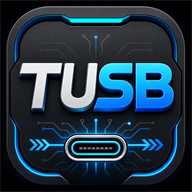
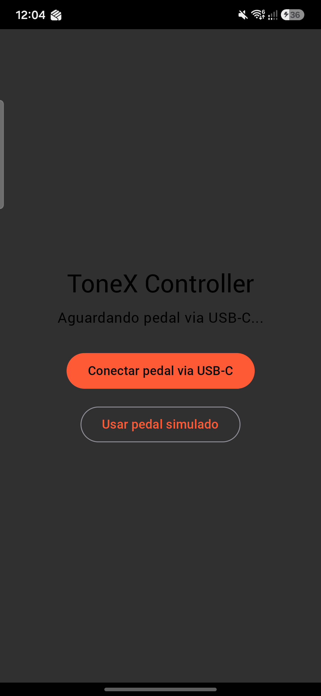
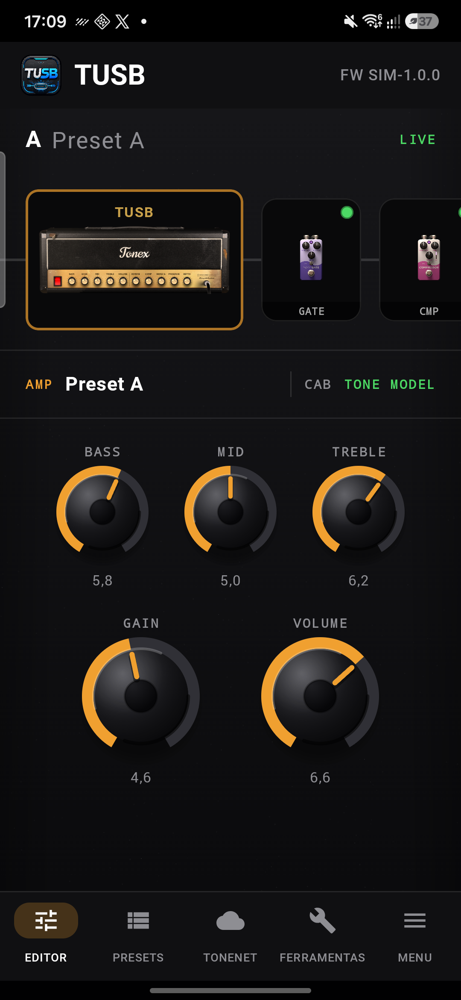
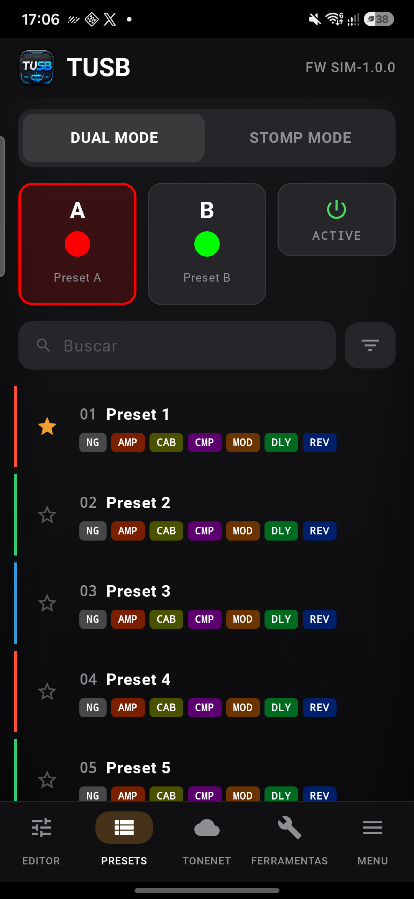
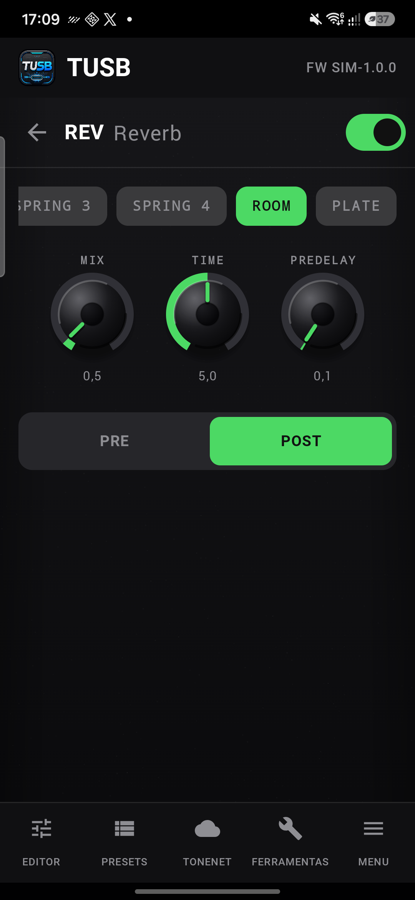
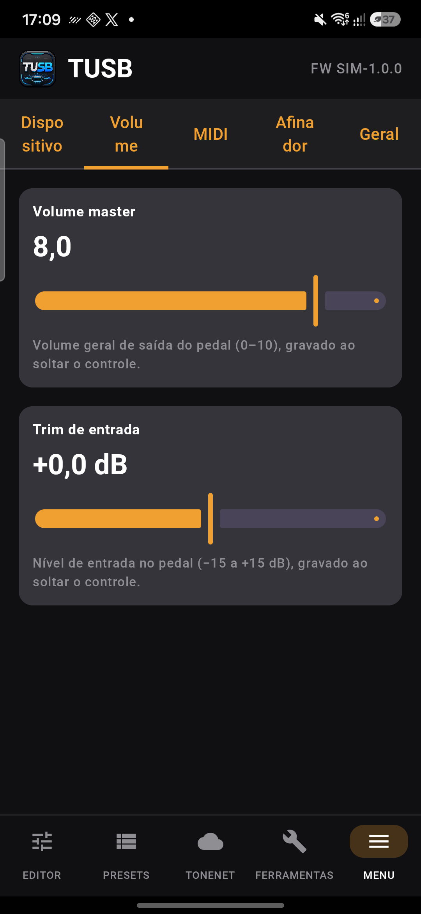
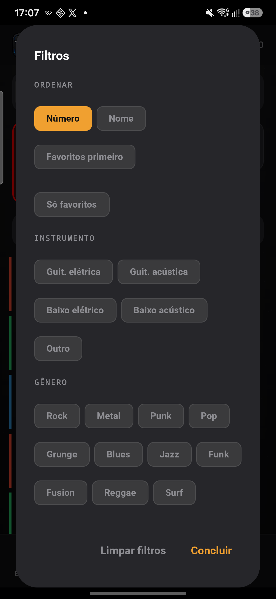
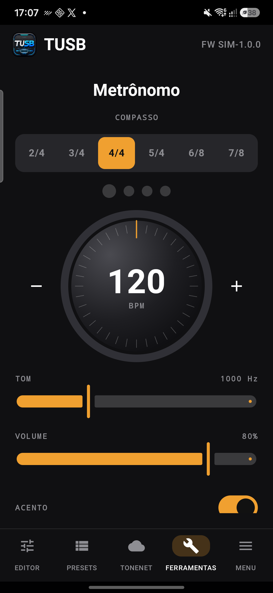
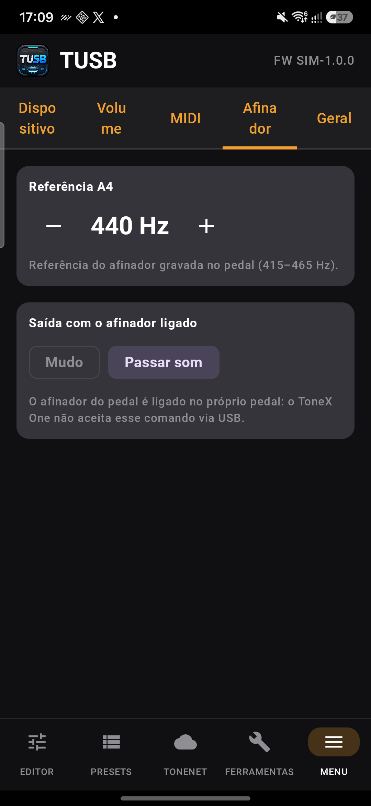

<p align="center">
  
</p>

<h1 align="center">TUSB - ToneX One USB Controller</h1>

<p align="center">
  <strong>Controle Android nativo via USB-C para ToneX One.</strong><br/>
  <strong>Native Android USB-C controller for ToneX One.</strong><br/>
  <strong>Controlador Android nativo por USB-C para ToneX One.</strong>
</p>

<p align="center">
  
  
  
  
</p>

<p align="center">
  🇧🇷 <a href="#-português-brasil">Português Brasil</a> &nbsp;|&nbsp;
  🇺🇸 <a href="#-english-us">English US</a> &nbsp;|&nbsp;
  🇪🇸 <a href="#-español">Español</a>
</p>

---

## 📦 APK V1.0.10 / VirusTotal

### 🇧🇷 Português Brasil

**Baixe o APK oficial da release:**
👉 [TUSB-v1.0.10.apk](https://github.com/acf1210/TUSB/releases/download/v1.0.10/TUSB-v1.0.10.apk)

**Verificação VirusTotal:** gerada automaticamente pelo workflow da release.
**Relatório:** [VIRUSTOTAL.md](https://github.com/acf1210/TUSB/releases/download/v1.0.10/VIRUSTOTAL.md)

**Regra para novas versões:** toda nova release com APK deve atualizar o VirusTotal automaticamente via [release automation](docs/RELEASE_AUTOMATION.md).

### 🇺🇸 English US

**Download the official release APK:**
👉 [TUSB-v1.0.10.apk](https://github.com/acf1210/TUSB/releases/download/v1.0.10/TUSB-v1.0.10.apk)

**VirusTotal scan:** generated automatically by the release workflow.
**Report:** [VIRUSTOTAL.md](https://github.com/acf1210/TUSB/releases/download/v1.0.10/VIRUSTOTAL.md)

**Rule for new versions:** every new release with an APK must update VirusTotal automatically via [release automation](docs/RELEASE_AUTOMATION.md).

### 🇪🇸 Español

**Descarga el APK oficial de la release:**
👉 [TUSB-v1.0.10.apk](https://github.com/acf1210/TUSB/releases/download/v1.0.10/TUSB-v1.0.10.apk)

**Verificación VirusTotal:** generada automaticamente por el workflow de release.
**Informe:** [VIRUSTOTAL.md](https://github.com/acf1210/TUSB/releases/download/v1.0.10/VIRUSTOTAL.md)

**Regla para nuevas versiones:** cada nueva release con APK debe actualizar VirusTotal automáticamente mediante [release automation](docs/RELEASE_AUTOMATION.md).

---

<p align="center">
  
  
  
  
  
</p>
<p align="center">
  
  
  
</p>

---

## 🇧🇷 Português Brasil

### Destaques da V1.0.10

- Os presets passam a ter o nome do Tone Model aplicado (lista de Presets, botões A/B/C e Editor), lido do pedal em segundo plano após conectar.
- Busca e ordenação por nome também usam o Tone Model; apelidos locais continuam tendo prioridade.

### Destaques da V1.0.9

- Checagem automática de atualização ao abrir o app (no máximo a cada 12 h), com aviso, novidades e botão para baixar o APK.
- Menu → Geral: versão instalada, "Verificar agora" e opção para desligar a checagem automática.

### Destaques da V1.0.8

- Biblioteca de Tone Models (botão na aba Presets): salva no celular qualquer preset do pedal com o Tone Model completo e grava de volta em qualquer posição, com backup automático e confirmação.
- Arquivos `.tusbtone` para exportar, importar e compartilhar presets entre usuários do TUSB.
- Tone Models do ToneNET: carregue pelo app oficial e salve no TUSB.

### Destaques da V1.0.7

- Ajustes do pedal gravados via USB no Menu: volume master, trim de entrada, referência A4,
  saída com o afinador ligado (mudo/passar som), BPM global e fonte do tempo. Validados no
  ToneX One real.
- Seletor de modelo em Reverb, Modulação e Delay, com os knobs acompanhando o modelo.
- Presets com favoritos, classificação por instrumento, gênero e caráter, filtros e ordenação.
- Metrônomo completo: compasso, roda de BPM, TAP, timbre, volume e acento.
- Protocolo dos ajustes globais documentado em [docs/protocol-notes.md](docs/protocol-notes.md).

### Destaques da V1.0.6

- Nova aba ToneNET para explorar Tone Models e presets públicos online, inclusive sem conectar o pedal.
- Navegação alinhada à referência oficial: Editor, Presets, ToneNET, Ferramentas e Menu.
- Acento âmbar consistente nos controles do Editor.

### Destaques da V1.0.5

- M-Vave Chocolate/FootCtrlPlus pareado por Bluetooth agora aparece na lista MIDI mesmo quando o Android expoe o pedal como HID/HOGP.
- MIDI Learn agora captura Program Change (`PC n`), alem de Control Change, para mapear os botoes de fabrica do Chocolate.
- Program Change mapeado tem prioridade sobre o carregamento direto de preset.

### Destaques da V1.0.4

- Seletor de modo do CAB no detalhe do efeito: Tone Model, VIR e Off.
- Cadeia de efeitos respeita a posição Pre/Post dos blocos mapeados.
- Temas locais Classic, Stage e Ocean no Menu.
- Correções de sincronização de estado para bypass, modo do pedal e parâmetros do preset.

### Destaques da V1.0.3

- Editor TUSB redesenhado com knobs pretos 3D, fundo escuro texturizado e cadeia de efeitos visual.
- Controles reais de amp/efeitos validados no ToneX One: Gain, EQ, Volume, toggles e detalhes de efeito via `0x0309`.
- Volume do Editor ajustado para o parametro capturado no hardware (`paramIndex=8`) e serial/FW completos na barra superior.
- Presets com personalizacao local de amp/cab e telas Connect, Editor, Presets e Detalhe alinhadas ao novo visual.

### Destaques da V1.0.2

- Suporte a footswitches MIDI por Bluetooth LE (M-Vave Chocolate e similares) e USB MIDI
  (via hub OTG).
- Mapa padrão pronto para uso: Program Change 0–19 carrega os presets 1–20 e CCs controlam
  slots, bypass, efeitos da cadeia e knobs do amp.
- MIDI Learn para remapear qualquer ação direto no app (Menu → MIDI).

### Destaques da V1.0.1

- Idioma automático para Português Brasil, Inglês EUA e Espanhol.
- Afinador completo por microfone, com leitura de cents e atalhos para Standard, Drop D,
  meio tom abaixo, D Standard, Open G e DADGAD.
- Nota de conexão inicial destacada no app: coloque o ToneX One em modo Stomp e pressione o
  pedal três vezes para conectar.
- Nota em destaque: versão para iOS em desenvolvimento. Em breve.
- Documentação de instalação e uso em três idiomas.

### O que é

O **TUSB** é um app Android comunitário que conecta diretamente ao **ToneX One** por cabo
USB-C OTG. Ele usa comunicação serial USB nativa para editar presets, alternar slots,
controlar efeitos e manter o app sincronizado com o pedal em tempo real.

### Recursos

- Conexão USB-C direta, sem Bluetooth e sem computador.
- Troca de preset e slot A/B/C.
- Alternância entre modo A/B e modo Stomp.
- Bypass geral e bypass IR/Cab.
- Knobs de amplificador em tempo real.
- Cadeia de efeitos editável: Gate, Compressor, EQ, Mod, Delay, Reverb e Cab, com seletor de
  modelo em Reverb, Mod e Delay.
- Ajustes globais gravados no pedal: volume master, trim, A4, afinador mudo/thru, BPM e fonte
  do tempo.
- Presets com favoritos, classificação, filtros e ordenação.
- Metrônomo com compasso, roda de BPM, TAP, timbre, volume e acento.
- Afinador por microfone com afinações comuns.
- Controle por footswitch MIDI (BLE e USB) com MIDI Learn.
- Captura JSONL para diagnóstico.

### Instalação e uso

- Instalação: [docs/INSTALL.md](docs/INSTALL.md)
- Guia de uso: [docs/USER_GUIDE.md](docs/USER_GUIDE.md)
- Resultado VirusTotal: [docs/VIRUSTOTAL.md](docs/VIRUSTOTAL.md)

### Build local

```bash
git clone https://github.com/acf1210/TUSB.git
cd TUSB
./gradlew assembleDebug
./gradlew test
```

O APK debug fica em `app/build/outputs/apk/debug/app-debug.apk`.

---

## 🇺🇸 English US

### V1.0.10 highlights

- Presets are now named after the Tone Model they use (Presets list, A/B/C footswitches and Editor), read from the pedal in the background after connecting.
- Search and name sort use the Tone Model too; local nicknames still take priority.

### V1.0.9 highlights

- Automatic update check on launch (at most every 12 h), with a notice, release notes, and a button to download the APK.
- Menu → General: installed version, "Check now", and a switch to turn the automatic check off.

### V1.0.8 highlights

- Tone Model library (button on the Presets tab): saves any pedal preset with its full Tone Model to the phone and writes it back to any slot, with an automatic backup and confirmation.
- `.tusbtone` files to export, import, and share presets between TUSB users.
- ToneNET Tone Models: load them with the official app, then save them in TUSB.

### V1.0.7 highlights

- Pedal settings written over USB from the Menu: master volume, input trim, A4 reference,
  output while tuning (mute/thru), global BPM, and tempo source. Validated on a real ToneX One.
- Model selector for Reverb, Modulation, and Delay, with the knobs following the model.
- Presets with favorites, instrument/genre/character tags, filters, and sorting.
- Full metronome: time signature, BPM wheel, TAP, tone, volume, and accent.
- Global-settings protocol documented in [docs/protocol-notes.md](docs/protocol-notes.md).

### V1.0.6 highlights

- New ToneNET tab for browsing public Tone Models and presets online, including while no pedal is connected.
- Navigation aligned with the official app: Editor, Presets, ToneNET, Tools, and Menu.
- Consistent amber accents across Editor controls.

### V1.0.5 highlights

- Paired M-Vave Chocolate/FootCtrlPlus devices now appear in the MIDI list even when Android exposes the pedal as HID/HOGP.
- MIDI Learn now captures Program Change (`PC n`) as well as Control Change, so factory Chocolate buttons can be mapped.
- Mapped Program Change messages take priority over direct preset loading.

### V1.0.4 highlights

- CAB mode selector in the effect detail screen: Tone Model, VIR, and Off.
- Effect chain now follows mapped Pre/Post block positions.
- Local Classic, Stage, and Ocean themes in Menu.
- State synchronization fixes for bypass, pedal mode, and preset parameters.

### V1.0.3 highlights

- TUSB editor redesign with black 3D knobs, darker textured background, and visual effect chain.
- Real ToneX One amp/effect controls validated on hardware: Gain, EQ, Volume, toggles, and effect details over `0x0309`.
- Editor Volume mapped to the hardware-captured parameter (`paramIndex=8`) and full serial/FW display in the top bar.
- Local amp/cab preset customization and Connect, Editor, Presets, and Effect Detail screens aligned with the new look.

### V1.0.2 highlights

- MIDI footswitch support over Bluetooth LE (M-Vave Chocolate and similar) and USB MIDI
  (through an OTG hub).
- Ready-to-use default map: Program Change 0–19 loads presets 1–20 and CCs control slots,
  bypass, effect chain blocks, and amp knobs.
- MIDI Learn to remap any action right in the app (Menu → MIDI).

### V1.0.1 highlights

- Automatic language support for Brazilian Portuguese, US English, and Spanish.
- Full microphone tuner with cents reading and shortcuts for Standard, Drop D, half-step
  down, D Standard, Open G, and DADGAD.
- Highlighted initial connection note in the app: put ToneX One in Stomp mode and press the
  pedal three times to connect.
- Highlighted note: iOS version in development. Coming soon.
- Install and user guides in three languages.

### What it is

**TUSB** is a community Android app that connects directly to **ToneX One** over a USB-C OTG
cable. It uses native USB serial communication to edit presets, switch slots, control
effects, and keep the app synchronized with the pedal in real time.

### Features

- Direct USB-C connection, no Bluetooth and no computer required.
- Preset and A/B/C slot switching.
- A/B and Stomp mode switching.
- Global bypass and IR/Cab bypass.
- Real-time amp knobs.
- Editable effect chain: Gate, Compressor, EQ, Mod, Delay, Reverb, and Cab, with a model
  selector for Reverb, Mod, and Delay.
- Global settings written to the pedal: master volume, trim, A4, tuner mute/thru, BPM, and
  tempo source.
- Presets with favorites, tags, filters, and sorting.
- Metronome with time signature, BPM wheel, TAP, tone, volume, and accent.
- Microphone tuner with common tunings.
- MIDI footswitch control (BLE and USB) with MIDI Learn.
- JSONL capture for diagnostics.

### Install and use

- Installation: [docs/INSTALL.md](docs/INSTALL.md)
- User guide: [docs/USER_GUIDE.md](docs/USER_GUIDE.md)
- VirusTotal result: [docs/VIRUSTOTAL.md](docs/VIRUSTOTAL.md)

### Local build

```bash
git clone https://github.com/acf1210/TUSB.git
cd TUSB
./gradlew assembleDebug
./gradlew test
```

The debug APK is generated at `app/build/outputs/apk/debug/app-debug.apk`.

---

## 🇪🇸 Español

### Novedades de la V1.0.10

- Los presets pasan a llevar el nombre del Tone Model aplicado (lista de Presets, botones A/B/C y Editor), leído del pedal en segundo plano al conectar.
- La búsqueda y el orden por nombre también usan el Tone Model; los apodos locales siguen teniendo prioridad.

### Novedades de la V1.0.9

- Búsqueda automática de actualizaciones al abrir la app (como máximo cada 12 h), con aviso, novedades y botón para descargar el APK.
- Menú → General: versión instalada, "Buscar ahora" y opción para desactivar la búsqueda automática.

### Novedades de la V1.0.8

- Biblioteca de Tone Models (botón en la pestaña Presets): guarda en el teléfono cualquier preset del pedal con su Tone Model completo y lo graba de vuelta en cualquier posición, con copia automática y confirmación.
- Archivos `.tusbtone` para exportar, importar y compartir presets entre usuarios de TUSB.
- Tone Models de ToneNET: cárgalos con la app oficial y guárdalos en TUSB.

### Novedades de la V1.0.7

- Ajustes del pedal guardados por USB desde el Menú: volumen master, trim de entrada,
  referencia A4, salida con el afinador activo (silencio/pasar sonido), BPM global y fuente
  del tempo. Validados en un ToneX One real.
- Selector de modelo en Reverb, Modulación y Delay, con los knobs siguiendo el modelo.
- Presets con favoritos, clasificación por instrumento, género y carácter, filtros y orden.
- Metrónomo completo: compás, rueda de BPM, TAP, timbre, volumen y acento.
- Protocolo de los ajustes globales documentado en [docs/protocol-notes.md](docs/protocol-notes.md).

### Novedades de la V1.0.6

- Nueva pestaña ToneNET para explorar Tone Models y presets públicos en línea, incluso sin conectar el pedal.
- Navegación alineada con la aplicación oficial: Editor, Presets, ToneNET, Herramientas y Menú.
- Acento ámbar consistente en los controles del Editor.

### Novedades de la V1.0.5

- M-Vave Chocolate/FootCtrlPlus emparejado por Bluetooth ahora aparece en la lista MIDI aunque Android exponga el pedal como HID/HOGP.
- MIDI Learn ahora captura Program Change (`PC n`), ademas de Control Change, para mapear los botones de fabrica del Chocolate.
- Program Change mapeado tiene prioridad sobre la carga directa de preset.

### Novedades de la V1.0.4

- Selector de modo CAB en el detalle del efecto: Tone Model, VIR y Off.
- La cadena de efectos respeta las posiciones Pre/Post de los bloques mapeados.
- Temas locales Classic, Stage y Ocean en el Menu.
- Correcciones de sincronizacion de estado para bypass, modo del pedal y parametros del preset.

### Novedades de la V1.0.3

- Editor TUSB redisenado con knobs negros 3D, fondo oscuro texturizado y cadena visual de efectos.
- Controles reales de amp/efectos validados en ToneX One: Gain, EQ, Volume, toggles y detalle de efectos via `0x0309`.
- Volume del Editor ajustado al parametro capturado en hardware (`paramIndex=8`) y serial/FW completos en la barra superior.
- Personalizacion local de amp/cab por preset y pantallas Connect, Editor, Presets y Detalle de Efecto alineadas al nuevo visual.

### Novedades de la V1.0.2

- Soporte de footswitches MIDI por Bluetooth LE (M-Vave Chocolate y similares) y USB MIDI
  (mediante hub OTG).
- Mapa por defecto listo para usar: Program Change 0–19 carga los presets 1–20 y los CCs
  controlan slots, bypass, bloques de efectos y knobs del amplificador.
- MIDI Learn para reasignar cualquier acción directamente en la app (Menú → MIDI).

### Novedades de la V1.0.1

- Idioma automático para Portugués Brasil, Inglés EUA y Español.
- Afinador completo por micrófono, con lectura de cents y accesos rápidos para Standard,
  Drop D, medio tono abajo, D Standard, Open G y DADGAD.
- Nota destacada de conexión inicial en la app: pon el ToneX One en modo Stomp y presiona el
  pedal tres veces para conectar.
- Nota destacada: versión para iOS en desarrollo. Próximamente.
- Guías de instalación y uso en tres idiomas.

### Qué es

**TUSB** es una app Android comunitaria que se conecta directamente al **ToneX One** con un
cable USB-C OTG. Usa comunicación serial USB nativa para editar presets, cambiar slots,
controlar efectos y mantener la app sincronizada con el pedal en tiempo real.

### Funciones

- Conexión USB-C directa, sin Bluetooth y sin ordenador.
- Cambio de preset y slots A/B/C.
- Cambio entre modo A/B y modo Stomp.
- Bypass general y bypass IR/Cab.
- Knobs de amplificador en tiempo real.
- Cadena de efectos editable: Gate, Compressor, EQ, Mod, Delay, Reverb y Cab, con selector de
  modelo en Reverb, Mod y Delay.
- Ajustes globales guardados en el pedal: volumen master, trim, A4, afinador silencio/thru,
  BPM y fuente del tempo.
- Presets con favoritos, clasificación, filtros y orden.
- Metrónomo con compás, rueda de BPM, TAP, timbre, volumen y acento.
- Afinador por micrófono con afinaciones comunes.
- Control por footswitch MIDI (BLE y USB) con MIDI Learn.
- Captura JSONL para diagnóstico.

### Instalación y uso

- Instalación: [docs/INSTALL.md](docs/INSTALL.md)
- Guía de uso: [docs/USER_GUIDE.md](docs/USER_GUIDE.md)
- Resultado VirusTotal: [docs/VIRUSTOTAL.md](docs/VIRUSTOTAL.md)

### Build local

```bash
git clone https://github.com/acf1210/TUSB.git
cd TUSB
./gradlew assembleDebug
./gradlew test
```

El APK debug se genera en `app/build/outputs/apk/debug/app-debug.apk`.

---

## Créditos e fontes / Credits and sources / Créditos y fuentes

### 🇧🇷 Português Brasil

Este projeto foi construído de forma independente e validado de maneira cruzada contra
projetos open-source da comunidade. Agradecemos às seguintes fontes:

- [`vit3k/tonex_controller`](https://github.com/vit3k/tonex_controller) — firmware ESP32
  open-source usado como referência para validar o framing HDLC/CRC e os offsets de
  slot/preset.
- [`Builty/TonexOneController`](https://github.com/Builty/TonexOneController) — firmware
  ESP32 open-source; segunda validação independente do protocolo (Hello/wake, RequestState,
  baud 115200), tabela de ranges de parâmetros (`tonex_params.c`) e mapa dos ajustes globais e
  do volume master (`usb_tonex_one.c`), conferidos contra capturas deste projeto e testados
  no pedal.
- [Android MIDI API](https://developer.android.com/reference/android/media/midi/package-summary)
  (`android.media.midi`) e a especificação **BLE MIDI** da MIDI Association para o suporte a
  footswitches na V1.0.2.

### 🇺🇸 English US

This project was built independently and cross-validated against community open-source
projects. We thank the following sources:

- [`vit3k/tonex_controller`](https://github.com/vit3k/tonex_controller) — open-source ESP32
  firmware used as a reference to validate HDLC/CRC framing and slot/preset offsets.
- [`Builty/TonexOneController`](https://github.com/Builty/TonexOneController) — open-source
  ESP32 firmware; a second independent validation of the protocol (Hello/wake, RequestState,
  baud 115200), parameter-range table (`tonex_params.c`), and the global-settings and
  master-volume map (`usb_tonex_one.c`), checked against this project's captures and tested
  on the pedal.
- [Android MIDI API](https://developer.android.com/reference/android/media/midi/package-summary)
  (`android.media.midi`) and the MIDI Association **BLE MIDI** specification for the V1.0.2
  footswitch support.

### 🇪🇸 Español

Este proyecto se construyó de forma independiente y se validó de forma cruzada contra
proyectos open-source de la comunidad. Agradecemos a las siguientes fuentes:

- [`vit3k/tonex_controller`](https://github.com/vit3k/tonex_controller) — firmware ESP32
  open-source usado como referencia para validar el framing HDLC/CRC y los offsets de
  slot/preset.
- [`Builty/TonexOneController`](https://github.com/Builty/TonexOneController) — firmware
  ESP32 open-source; segunda validación independiente del protocolo (Hello/wake,
  RequestState, baud 115200), tabla de rangos de parámetros (`tonex_params.c`) y mapa de los
  ajustes globales y del volumen master (`usb_tonex_one.c`), contrastados con capturas de
  este proyecto y probados en el pedal.
- [Android MIDI API](https://developer.android.com/reference/android/media/midi/package-summary)
  (`android.media.midi`) y la especificación **BLE MIDI** de la MIDI Association para el
  soporte de footswitches en la V1.0.2.

---

## Legal

This is an independent community interoperability project. It is not affiliated with,
endorsed by, or sponsored by any trademark owner. The original source code in this
repository is distributed under the [MIT license](LICENSE).
